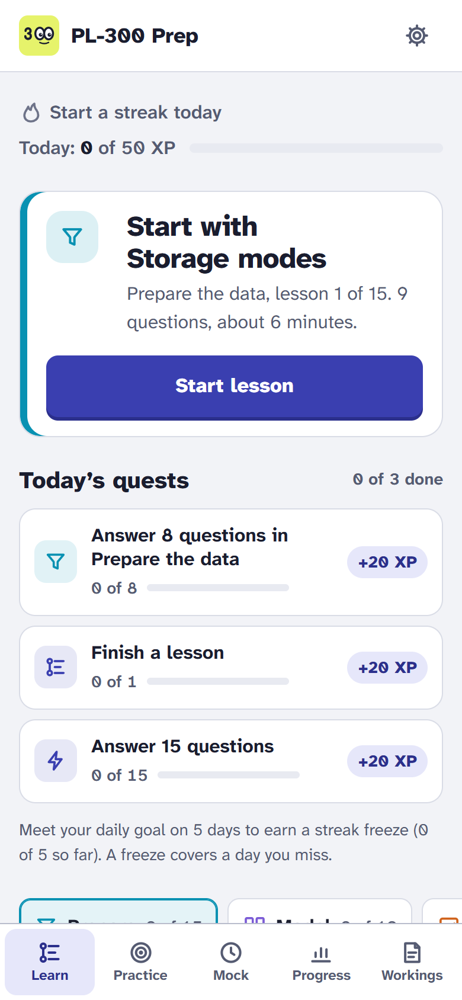
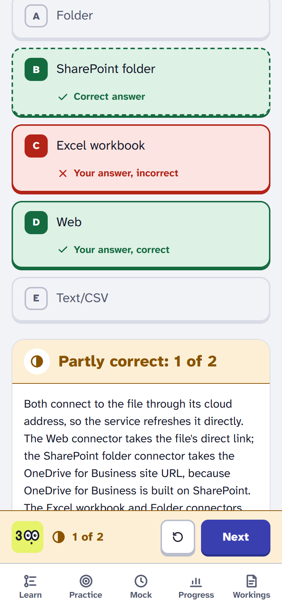
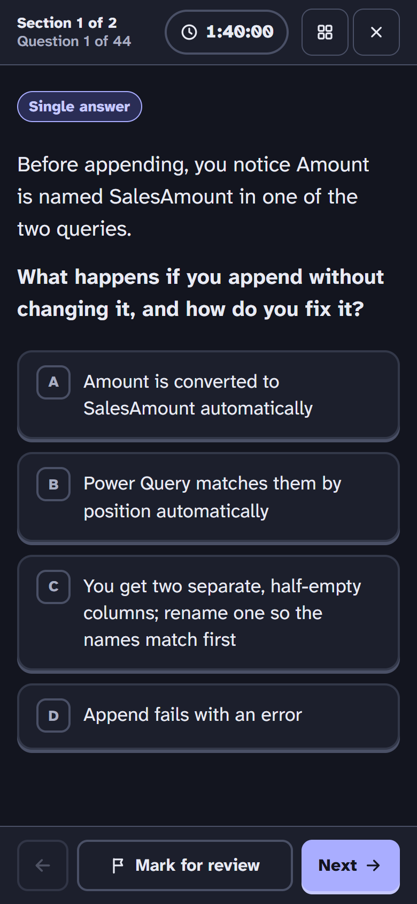
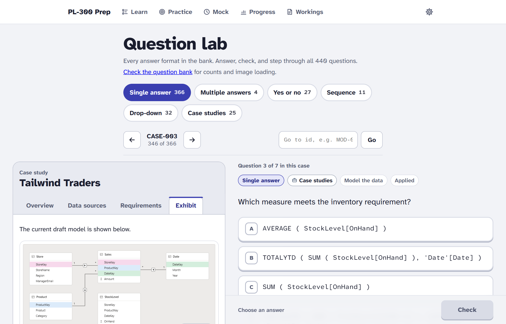
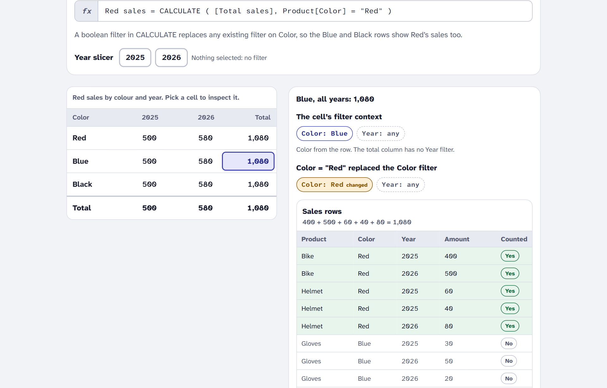

# PL-300 Prep

A study app for the Microsoft PL-300 (Power BI Data Analyst) exam: short lessons, targeted practice with spaced repetition, full timed mock exams with case studies, and interactive concept simulators. Mobile-first, installable, and it works offline.

**Live: [pl300-prep.pages.dev](https://pl300-prep.pages.dev)**. Open it on a phone and add it to your home screen to install it.

Not affiliated with or endorsed by Microsoft. "PL-300" is used descriptively. All 440 questions and 94 exhibits are original.

<p>
  
  
  
</p>

<p>
  
</p>

## What's in it

- **Googly:** the app's mark and its one character, "300" with the zeros drawn as eyes. Its eyes follow your pointer in the header; in lessons and practice it cheers a right answer, winces at a wrong one, and throws highlighter-stroke confetti when you finish a lesson. Right answers pop their XP, and three or more in a row show as a combo. The mock exam stays serious, and Reduce motion stills all of it.
- **Learn:** laid out like Power Query's editor: the exam domains as queries, each with its lessons as Applied steps, ticked and highlighted as you finish them. Missed questions come back at the end of a lesson.
- **Daily quests and streaks:** three quests a day chosen from your own reviews, mistakes and weakest domain, each a link into the right run and worth bonus XP; a daily XP goal; streak freezes earned by meeting it, which cover a missed day.
- **Practice:** filter by domain, topic, subtopic and difficulty; a review queue scheduled by spaced repetition (Leitner boxes), a mistakes queue, flagged questions and flashcards.
- **Mock exams:** 50 questions weighted like the real exam, a 100-minute timer, mark for review, a question map, and a case-study section that locks the one before it. Results show an estimated score out of 1,000 and a breakdown by domain.
- **Five question formats** as the exam uses them: single and multiple answers, yes/no statements, drop-down parts, and build-a-sequence (drag, or tap and use buttons). Exhibits zoom and pan; case studies open beside the question on wide screens and as a sheet on phones.
- **Concept simulators:** join kinds, Append vs Merge, filter context and context transition, and star vs snowflake. Change the inputs and watch Power Query or DAX respond.

<p>
  
</p>

- **Progress:** a readiness estimate on the exam's own 0–1,000 scale with the pass mark (labelled as an estimate), mastery by domain, milestones tied to the exam, weakest subtopics with a one-tap practice run, and the mock score trend.
- **My workings:** notes on questions and topics (Markdown), flags, and problem reports you can export. One-file backup and restore of everything.
- **Settings:** light, dark or device theme; text size; reduce motion; daily XP goal; install and offline status.

## Quality

- **Accessible:** keyboard throughout, a visible focus ring on every control, focus moved to each new page's heading, text alternatives for every exhibit, at least 4.5:1 contrast, and right or wrong is never shown by colour alone. Checked with axe-core (WCAG 2.2 AA plus best practices) in light and dark, by keyboard specs, and in Windows High Contrast.
- **Offline and installable:** a service worker precaches the app and every exhibit (2.3 MB), so a mock exam works with no connection. Updates wait for you to choose Reload, and never interrupt a lesson or exam.
- **Secure by default:** a strict Content-Security-Policy (same-origin only, no inline script or style, no eval), sent in production and in the end-to-end tests.
- **Fast:** the start-up JavaScript is 117 kB gzipped; every other page, the question bank and the simulators load when first needed.
- **Private:** everything is stored on your device (IndexedDB), and nothing is sent anywhere.
- **Tested:** 180 unit and component tests (Vitest, Testing Library) and 180 end-to-end tests (Playwright) on a 375px phone and a desktop, against the production build. They cover the acceptance checks: every question and exhibit loads, each format scores, a full mock times out and locks its case section, and progress survives a reload and a backup round trip. Every end-to-end test also fails on any console error, failed request or CSP violation.

## Tech

React 19 and TypeScript (strict), Vite, React Router, Zod for the question bank and backups, CSS Modules over design tokens, dnd-kit for ordering, vite-plugin-pwa (Workbox), Vitest and Playwright with axe-core, Cloudflare Pages. See [docs/ARCHITECTURE.md](docs/ARCHITECTURE.md) for the design and the decisions behind it, step by step.

## Getting started

Requires Node 20.19+ or 22.12+.

```bash
npm install
npm run dev
```

Then open http://localhost:5173.

## Scripts

| Script                   | What it does                                                                 |
| ------------------------ | ---------------------------------------------------------------------------- |
| `npm run dev`            | Start the dev server                                                         |
| `npm run build`          | Check the bank, typecheck, and build to `dist/`                              |
| `npm run preview`        | Serve the build locally, with the production security headers                |
| `npm run verify`         | Format check, lint, typecheck, unit tests and build: what CI runs before e2e |
| `npm test`               | Unit and component tests                                                     |
| `npm run test:e2e`       | End-to-end tests against `dist/` (build first)                               |
| `npm run check:bank`     | Validate the question bank and confirm every image exists                    |
| `npm run lint`           | Lint with ESLint                                                             |
| `npm run typecheck`      | Typecheck with TypeScript                                                    |
| `npm run format`         | Format with Prettier                                                         |
| `npm run deploy:check`   | Build and check `dist/` for deployment, upload nothing                       |
| `npm run deploy:preview` | Deploy to the Cloudflare Pages preview branch                                |
| `npm run deploy`         | Deploy to production                                                         |

### End-to-end tests

The first time, install Playwright's Chromium (`npx playwright install chromium`), or use a browser you already have by setting `PW_CHANNEL`:

```bash
PW_CHANNEL=msedge npm run test:e2e
```

To run the same suite against a deployed site instead of a local build, set `PW_BASE_URL`:

```bash
PW_BASE_URL=https://test.pl300-prep.pages.dev npm run test:e2e
```

CI (`.github/workflows/ci.yml`) runs the full gate and the end-to-end suite on every push and pull request.

## Content

Questions and exhibits live in [`pl300-bank/`](pl300-bank/README.md); the format is defined in [`pl300-bank/SCHEMA.md`](pl300-bank/SCHEMA.md). The app treats the bank as read-only: corrections are made there and picked up on the next build, which validates every question first. Progress is stored by question id, so the bank can change without breaking anyone's history.

Current bank: 440 questions (prepare 132, model 120, visualize 106, manage 57, case 25) across five formats, 4 case studies and 94 exhibits.
